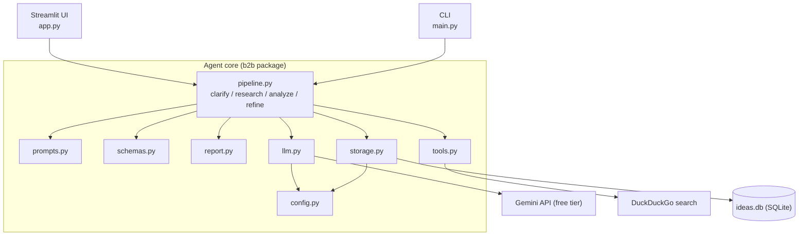

# Brain-to-Business: System Architecture

Brain-to-Business is an AI agent that turns a raw thought into a structured startup brief:
a clarified idea, real competitors, target customers, revenue models, a scored evaluation,
and a week-by-week MVP roadmap.

It runs on the free Gemini API tier, uses DuckDuckGo for web search (no key needed), and stores
history in a local SQLite file.

---

## 1. High-level diagram

```
        ┌───────────────────┐        ┌───────────────────┐
        │  Streamlit web UI │        │    Command line   │
        │      app.py       │        │      main.py      │
        └─────────┬─────────┘        └─────────┬─────────┘
                  │                            │
                  ▼                            ▼
┌ ─ ─ ─ ─ ─ ─ ─ ─ ─ ─ ─ ─ ─ ─ ─ ─ ─ ─ ─ ─ ─ ─ ─ ─ ─ ─ ─ ─ ─ ─ ─ ─ ─ ┐
  Agent core  (b2b package)
│                                                                   │
  ┌───────────────────────────────────────────────────────────────┐
│ │  pipeline.py   clarify → research → analyze → refine          │ │
  └───────────────────────────────────────────────────────────────┘
│                                                                   │
  ┌────────────┐ ┌────────────┐ ┌────────────┐ ┌────────────┐
│ │ prompts.py │ │ schemas.py │ │ report.py  │ │ config.py  │       │
  └────────────┘ └────────────┘ └────────────┘ └────────────┘
│                                                                   │
        ┌────────────┐   ┌────────────┐   ┌────────────┐
│       │  llm.py    │   │  tools.py  │   │ storage.py │            │
        └─────┬──────┘   └─────┬──────┘   └─────┬──────┘
└ ─ ─ ─ ─ ─ ┼ ─ ─ ─ ─ ─ ─ ─ ─ ┼ ─ ─ ─ ─ ─ ─ ─ ─ ┼ ─ ─ ─ ─ ─ ─ ─ ─ ┘
            ▼                 ▼                 ▼
      ┌───────────┐     ┌────────────┐     ┌───────────┐
      │ Gemini API│     │ DuckDuckGo │     │ ideas.db  │
      │ (free)    │     │  search    │     │ (SQLite)  │
      └───────────┘     └────────────┘     └───────────┘
```

The same diagram as Mermaid (renders on GitHub and in VS Code with a Mermaid preview extension):



---

## 2. The three layers

### Interfaces
| File | Role |
|---|---|
| `app.py` | Streamlit web UI: idea input, confirmation step, live progress, tabbed results, refine, compare, download |
| `main.py` | Command line: analyze, `--list`, `--show`, `--compare`, `--refine` |

Neither contains business logic. Both call the same functions in `pipeline.py` and `storage.py`,
so they always give identical results.

### Agent core (`b2b/`)

**Orchestration**
| File | Role |
|---|---|
| `pipeline.py` | Runs the steps in order and passes everything learned so far into each next step |

**Helpers (pure logic, no network)**
| File | Role |
|---|---|
| `prompts.py` | One system prompt per step |
| `schemas.py` | Pydantic models every step must return, plus the combined `Brief` |
| `report.py` | Renders a `Brief` as Markdown and builds comparison tables |
| `config.py` | Reads settings from `.env` |

**Adapters (the only files that touch the outside world)**
| File | Role |
|---|---|
| `llm.py` | Gemini wrapper: structured JSON output, retries with backoff, friendly errors |
| `tools.py` | Web search with de-duplication of results |
| `storage.py` | SQLite save, list, load, delete |

### External services
| Service | Used for | Cost |
|---|---|---|
| Gemini API | All reasoning and structured output | Free tier (rate-limited) |
| DuckDuckGo (`ddgs` package) | Competitor research | Free, no key |
| `ideas.db` | Saved ideas | Local file |

---

## 3. Request flow

What happens when you submit an idea:

1. **Clarify.** `pipeline.clarify()` sends your raw text to Gemini and gets back a `Clarified`
   object: problem, solution, one-line pitch, assumptions, and up to two follow-up questions.
2. **Human checkpoint.** You confirm or correct the understanding. Corrections re-run clarify with
   your feedback, so effort is never spent on a misunderstood idea.
3. **Research.** `tools.py` runs two web searches. The results go to Gemini, which extracts real
   competitors and the gaps a new entrant could exploit.
4. **Customers, revenue, evaluation, roadmap.** Four more calls run in sequence. Each one receives
   a JSON bundle of everything produced so far, so the evaluation is grounded in the research.
5. **Assemble and save.** The results are combined into one `Brief`. `storage.py` saves it as JSON
   in SQLite and `report.py` renders it for display or download.

```
raw idea
  └─► 1 Clarify ──► (you confirm)
        └─► 2 Research ──► 3 Customers ──► 4 Revenue ──► 5 Evaluate ──► 6 Roadmap
                                                                  └──────────┬─────────┘
                                                                             ▼
                                                              Brief ─► SQLite + Markdown
```

### Evaluation rubric
The evaluation step scores six fixed criteria from 1 to 10, each with a one-sentence reason:

1. Problem severity
2. Market size
3. Competition level (10 = little competition)
4. MVP ease (10 = very easy to build)
5. Monetization clarity
6. Founder effort/fit (10 = low effort for a small team)

The overall score is computed in code as the average, not by the model. Criterion names are
normalized after the call so any two ideas can be compared side by side.

---

## 4. Data model

Every step returns a validated Pydantic object, never free text.

| Step | Schema | Key fields |
|---|---|---|
| Clarify | `Clarified` | problem, solution, one_liner, assumptions, follow_up_questions |
| Research | `Research` | competitors (name, what_they_do, url, weakness), market_notes |
| Customers | `Customers` | segments (name, pain_level, where_to_find_them) |
| Revenue | `Revenue` | models (name, how_it_works, pricing_logic) |
| Evaluate | `Evaluation` | scores (criterion, score, reason), verdict, risks |
| Roadmap | `Roadmap` | first_validation_test, steps (week, goal, tasks, success_metric), tech_stack |
| Final | `Brief` | all of the above, plus raw_idea and a `grounded` flag |

`grounded` is `True` when competitor research used live search results. When search fails, the
pipeline still completes, the flag is `False`, and the report says the competitors came from model
knowledge and should be verified.

---

## 5. Design decisions

- **Structured output at every step.** Gemini must return JSON matching a schema, so the UI never
  parses free text. Scores are clamped to 1-10, and malformed output is retried.
- **Adapters isolated.** Only `llm.py`, `tools.py` and `storage.py` touch the outside world. To
  switch from Gemini to another provider, edit only `llm.py`.
- **Human in the loop.** The confirmation step catches misunderstandings before the expensive part.
- **Honest evaluation.** Prompts tell the model to be critical rather than cheerlead, and to ground
  scores in the research.
- **Graceful degradation.** A failed search or a flaky network produces a clear message or a clearly
  labeled fallback, not a crash.
- **Free-tier friendly.** A configurable pause between calls (`CALL_DELAY`) plus automatic retries
  for 429 and 5xx errors (10s, 20s, 40s backoff).
- **Prompt-injection awareness.** Web search text is passed to the model as untrusted data, and the
  research prompt says to treat it as data, never as instructions.
- **Testable.** The pipeline calls `ask()` from `llm.py`, so tests swap in a fake model and run with
  no API key or internet.

---

## 6. Configuration (`.env`)

| Variable | Default | Purpose |
|---|---|---|
| `GEMINI_API_KEY` | none | Free key from aistudio.google.com |
| `MODEL` | `gemini-2.5-flash` | Gemini model ID; check AI Studio for current names |
| `ENABLE_SEARCH` | `true` | Turn web search on or off |
| `CALL_DELAY` | `2` | Seconds between model calls |
| `MAX_RETRIES` | `4` | Attempts per call before giving up |
| `DB_PATH` | `ideas.db` | Location of the SQLite file |

---

## 7. Extension points

| To add | Touch |
|---|---|
| A different LLM provider | `llm.py` only |
| A new analysis step (e.g. pitch outline) | new schema in `schemas.py`, prompt in `prompts.py`, entry in the `analyze()` loop, section in `report.py` |
| Another data source (e.g. Reddit, Product Hunt) | `tools.py`, then feed results into the research step |
| PDF export | `report.py` |
| Multi-user deployment | swap SQLite in `storage.py` for Postgres and add auth in front of `app.py` |

---

## 8. Project layout

```
brain-to-business/
├── app.py              Streamlit UI
├── main.py             CLI
├── requirements.txt
├── .env.example
├── README.md
├── b2b/
│   ├── config.py       settings from .env
│   ├── llm.py          Gemini wrapper
│   ├── schemas.py      Pydantic models
│   ├── prompts.py      one prompt per step
│   ├── tools.py        web search
│   ├── pipeline.py     clarify / research / analyze / refine
│   ├── storage.py      SQLite history
│   └── report.py       Markdown rendering + comparison
├── tests/              pytest suite (fake model, no key needed)
└── reports/            generated Markdown reports
```
